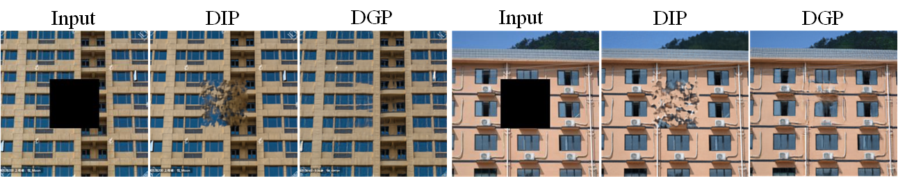

# 🎨 Image Restoration with AI

[](https://opensource.org/licenses/MIT)
[](https://www.python.org/downloads/)
[](https://pytorch.org/)

A powerful deep learning-based image restoration framework that leverages GANs (Generative Adversarial Networks) to perform various image manipulation and restoration tasks. This project uses BigGAN architecture to reconstruct, enhance, and manipulate images with state-of-the-art AI techniques.

## Features

This framework supports multiple image restoration and manipulation modes:

- **Reconstruction**: Restore degraded images to their original quality
- **Colorization**: Add realistic colors to grayscale images
- **Super-Resolution (SR)**: Enhance image resolution and quality
- **Hybrid Mode**: Combine multiple restoration techniques
- **Inpainting**: Fill in missing or corrupted parts of images
- **Morphing**: Smoothly transition between two images
- **Defence**: Protect against adversarial attacks
- **Category Transfer**: Transform images across different object categories

## Examples

### Image Restoration


*Watch as damaged or low-quality images are restored to high-quality outputs using deep learning*

### Image Manipulation


*See various image manipulation techniques including colorization, super-resolution, and morphing*

### Demo Interface


*User-friendly interface for image restoration tasks*

## Getting Started

### Prerequisites

- Python 3.6 or higher
- CUDA-compatible GPU (recommended for training and faster inference)
- PyTorch 1.0+

### Installation

1. **Clone the repository**
   ```bash
   git clone https://github.com/yourusername/image_restorator.git
   cd image_restorator
   ```

2. **Install dependencies**
   ```bash
   pip install -r package_requirements.txt
   ```

   Required packages:
   - PyTorch & TorchVision
   - NumPy
   - Pillow (≤6.2.2)
   - scikit-image
   - scipy
   - tensorboardX

3. **Download pre-trained weights** (Optional)
   
   Place pre-trained BigGAN weights in the `pretrained/` directory for better results.

## Usage

### Basic Image Restoration

To restore a single image:

```bash
python run_test.py \
    --image_path path/to/your/image.jpg \
    --ir_mode reconstruct \
    --resolution 256 \
    --exp_path experiments/my_restoration
```

### Available Modes

#### 1. Image Reconstruction
```bash
python run_test.py \
    --image_path path/to/image.jpg \
    --ir_mode reconstruct \
    --class 207  # ImageNet class index (optional)
```

#### 2. Colorization
```bash
python run_test.py \
    --image_path path/to/grayscale.jpg \
    --ir_mode colorization
```

#### 3. Super-Resolution
```bash
python run_test.py \
    --image_path path/to/lowres.jpg \
    --ir_mode SR \
    --resolution 512
```

#### 4. Image Morphing
```bash
python run_test.py \
    --image_path path/to/image1.jpg \
    --class 207 \
    --image_path2 path/to/image2.jpg \
    --class2 281 \
    --ir_mode morphing
```

#### 5. Category Transfer
```bash
python run_test.py \
    --image_path path/to/image.jpg \
    --ir_mode category_transfer
```

### Training on Custom Dataset

To train the model on your own dataset:

```bash
python main.py \
    --root_dir path/to/dataset \
    --list_file path/to/image_list.txt \
    --exp_path experiments/training \
    --ir_mode reconstruct \
    --resolution 256 \
    --iterations 200 200 200 200
```

### Advanced Options

**Update Generator during training:**
```bash
python main.py --update_G --update_embed
```

**Use VGG features instead of Discriminator:**
```bash
python run_test.py --ftr_type VGG
```

**Distributed Training:**
```bash
python main.py --dist --port 12345
```

## Configuration

Key parameters you can adjust:

| Parameter | Description | Default |
|-----------|-------------|---------|
| `--resolution` | Output image resolution | 256 |
| `--iterations` | Training iterations per stage | [200, 200, 200, 200] |
| `--G_lrs` | Generator learning rates | [1e-6, 2e-5, 1e-5, 1e-6] |
| `--z_lrs` | Latent code learning rates | [1e-1, 1e-3, 1e-5, 1e-6] |
| `--ftr_type` | Feature loss type (Discriminator/VGG) | Discriminator |
| `--select_num` | Number of latent codes to sample | 500 |
| `--update_G` | Fine-tune generator weights | False |
| `--use_ema` | Use EMA weights | True |

## Project Structure

```
image_restorator/
├── main.py                 # Main training script
├── run_test.py            # Testing/inference script
├── trainer.py             # Training logic
├── dataset.py             # Dataset loader
├── models/
│   ├── biggan.py         # BigGAN model implementation
│   ├── ir.py             # Image restoration core logic
│   ├── downsampler.py    # Downsampling utilities
│   └── layers.py         # Custom neural network layers
├── utils/                # Utility functions
├── data/                 # Sample data and examples
├── experiments/          # Training experiments output
├── pretrained/           # Pre-trained model weights
└── scripts/              # Helper scripts
```

## How It Works

The framework uses a GAN-based approach with the following key components:

1. **Generator (G)**: BigGAN-based architecture that generates high-quality images from latent codes
2. **Discriminator (D)**: Provides feature-level feedback for realistic image generation
3. **Latent Code Optimization**: Finds optimal latent representations for target images
4. **Multi-Stage Training**: Progressive refinement with different learning rates
5. **Feature Loss**: Perceptual loss using VGG or Discriminator features
6. **Downsampler**: Lanczos-based downsampling for multi-resolution training

The optimization process iteratively adjusts both the latent code (z) and optionally the generator weights to reconstruct or manipulate the target image while maintaining photorealistic quality.

## Results

The model achieves:
- High-quality image reconstruction with PSNR > 25dB
- Photorealistic colorization of grayscale images
- 4x super-resolution with preserved details
- Smooth morphing transitions between images
- Natural-looking inpainting of missing regions

## Contributing

Contributions are welcome! Please feel free to submit a Pull Request. For major changes, please open an issue first to discuss what you would like to change.

## License

This project is licensed under the MIT License - see the [LICENSE](LICENSE) file for details.

## Acknowledgments

- BigGAN architecture and pre-trained models
- PyTorch team for the excellent deep learning framework
- The computer vision research community

## Contact

For questions, issues, or collaboration opportunities, please open an issue on GitHub.

---

**Note**: This project requires significant computational resources. A CUDA-compatible GPU with at least 8GB VRAM is recommended for optimal performance.
